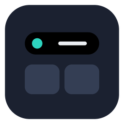

<div align="center">



# Lintel

**A smart control and notification center that sits on top of your screen.**

Notifications, live activities, media controls and quick widgets, in one small bar at the top of Windows and macOS.

[](#installation)
[](https://v2.tauri.app)
[](LICENSE)


</div>

## Contents

- [Overview](#overview)
- [Features](#features)
- [Screenshots](#screenshots)
- [Installation](#installation)
- [Getting started](#getting-started)
- [Browser extension](#browser-extension)
- [Local API](#local-api)
- [Building from source](#building-from-source)
- [Project structure](#project-structure)
- [License](#license)

## Overview

Lintel puts a small island at the top center of your screen. It stays out of the way until something happens: a notification slides out, music bars appear while sound plays, and a timer counts down beside it. Hover over it to open a panel of widgets and system controls, so you don't have to dig through the tray, the Action Center or several separate apps.

Clicks pass through everywhere outside the island, so the apps below it keep working. When a full-screen app, game, video or presentation is in front, the island steps aside.

## Features

| | |
|---|---|
| **Notifications** | Pop out of the island for a few seconds, then wait in the Notifications tab. Do Not Disturb keeps them quiet. |
| **Live activities** | A running timer, unread count, music bars, and green and orange dots while an app uses the camera or microphone. |
| **Now playing** | Cover art, title and playback controls for Spotify, Apple Music, any app in the Windows media flyout, and websites. |
| **Controls** | Wi-Fi, Bluetooth, airplane mode, dark mode, night light or Night Shift, energy saver, volume and brightness. |
| **Widgets** | Clock, Calendar, Timer, System (CPU, memory, battery), Notes, Weather, Stocks, Now playing, Controls and Quick actions. Drag to move, drag a corner to resize. |
| **Quick actions** | Record screen, screenshot, keep awake, Do Not Disturb, mute, lock, calculator, downloads. |
| **Stocks** | Live prices from Yahoo Finance, with Vietnamese stocks (HOSE, HNX, UPCoM) from VPS. Pin up to 3 symbols to the island. |
| **Website notifications** | A browser extension forwards notifications from Gmail, Slack, Discord and other sites. |
| **Local API** | Scripts, CI jobs and tools can send notifications over HTTP. |
| **Themes** | Graphite, Black, Midnight, Aurora, Ember, Slate, Transparent, or your own pictures, framed with a built-in cropper. |
| **Two styles** | *Notch*, hanging from the top edge, or a floating capsule just below it. Both can be resized. |
| **8 languages** | English, 简体中文, Tiếng Việt, 日本語, 한국어, Español, Français and Deutsch. Lintel follows your system language. |

## Screenshots

<table>
  <tr>
    <td align="center" width="50%">
      <br>
      <sub><b>Widget panel</b></sub>
    </td>
    <td align="center" width="50%">
      <br>
      <sub><b>Notification</b></sub>
    </td>
  </tr>
  <tr>
    <td align="center">
      <br>
      <sub><b>Now playing</b></sub>
    </td>
    <td align="center">
      <br>
      <sub><b>Settings</b></sub>
    </td>
  </tr>
</table>

## Installation

> Prebuilt installers are published on the [Releases page](https://github.com/TanPhan263/DynamicWidget/releases). Until the first release is out, [build from source](#building-from-source).

### Windows

1. Download the latest `Lintel_x.y.z_x64-setup.exe` (or the `.msi`) from the [Releases page](https://github.com/TanPhan263/DynamicWidget/releases).
2. Run the installer. If Windows SmartScreen warns that the app is unrecognized, choose **More info → Run anyway**. The installer isn't code-signed yet.
3. Lintel starts in the system tray. The Settings window opens on first launch with a short welcome.

Requires Windows 10 or 11 (64-bit). The installer downloads the Microsoft WebView2 runtime if it's missing.

### macOS

Requires macOS 12 Monterey or later.

1. Download the latest `Lintel_x.y.z_*.dmg` from the [Releases page](https://github.com/TanPhan263/DynamicWidget/releases).
2. Open the disk image and drag **Lintel** to **Applications**.
3. The app isn't notarized yet. The first time, right-click Lintel in Applications and choose **Open**, then confirm.
4. Lintel runs from the menu bar. macOS asks for permissions only when you use a feature that needs them, such as screen recording or controlling Spotify and Music.

## Getting started

| Action | How |
|---|---|
| Open the island | Hover over it (or click it, if you prefer, in Settings) |
| Toggle from anywhere | `Ctrl+Shift+Space` (Windows) / `Cmd+Shift+Space` (macOS) |
| Close | `Esc`, or move the pointer away |
| Arrange widgets | Drag a card to move it, drag its bottom-right corner to resize |
| Settings | Tray or menu bar icon → **Settings** |
| Quit | Tray or menu bar icon → **Quit Lintel** (closing Settings only hides it) |

## Browser extension

The extension in [`extension/`](extension/) forwards website notifications and now-playing info to Lintel. It works in Chrome, Edge, Brave, Arc and other Chromium browsers (version 111 or later).

1. Open `chrome://extensions` and turn on **Developer mode**.
2. Click **Load unpacked** and choose the `extension` folder. **Settings → Browser → Show folder** opens it.
3. Click the Lintel icon in the toolbar, paste the pairing token from **Settings → Browser** and click **Connect**.

Good to know:

- A site sends notifications only after you allow them in the browser, and only while it's open in a tab.
- To avoid seeing each notification twice, turn off the browser's own notifications in your system's notification settings. Lintel keeps receiving them.
- Each site can send at most 12 notifications a minute, and repeats within 3 seconds are dropped.
- Desktop apps (for example the Slack or Steam apps) use system notifications, which Lintel can't read. Neither macOS nor unpackaged Windows apps have a public API for that.

## Local API

Anything on your computer can send a notification:

```sh
curl -X POST http://127.0.0.1:47821/v1/notify \
  -H 'Content-Type: application/json' \
  -d '{"title":"Build passed","body":"main · 2m 14s","app":"CI","icon":"✅","accent":"#16a34a"}'
```

| Field | Description |
|---|---|
| `title` | Required, up to 120 characters |
| `body` | Optional, up to 500 characters |
| `app` | Sender name shown above the title (default `Script`) |
| `icon` | An emoji or up to 4 characters |
| `accent` | Icon background, as a hex color |
| `image` | A small picture instead of the icon: a base64 PNG, JPEG, WebP or GIF data URL, up to 12 KiB |

`GET /v1/health` checks that Lintel is running.

**Security:** the server listens on `127.0.0.1` only and accepts only JSON. It refuses requests from web pages and requests whose `Host` isn't the loopback address. Browser extensions must send the pairing token (`Authorization: Bearer <token>`). You can change the port or turn the API off in Settings.

## Building from source

**Requirements:** Node.js 20+, Rust 1.85+, and the [Tauri 2 prerequisites](https://v2.tauri.app/start/prerequisites/) for your OS.

```sh
git clone https://github.com/TanPhan263/DynamicWidget.git
cd DynamicWidget
npm install

npm run tauri dev              # run with hot reload
npm test                       # frontend tests (Vitest)
cd src-tauri && cargo test     # Rust tests
npm run tauri build            # installers: .msi / .exe on Windows, .app / .dmg on macOS
npm run icons                  # regenerate app and tray icons
```

Built installers are written to `src-tauri/target/release/bundle/`.

## Project structure

```text
src/
  island/            The island window: state machine, geometry, views and widgets
  settings/          The Settings window
  shared/            Types, IPC wrappers, events, formatting and translations
  components/ui/     shadcn-style UI components
src-tauri/src/
  core/              Island window, notifications, local API, system monitor, settings
  platform/          macOS (AppKit) and Windows (Win32) integration
  controls/          System controls: Wi-Fi, Bluetooth, volume, brightness and more
  tray.rs            Tray / menu bar menu
extension/           Chromium browser extension
```

The interface uses React, Tailwind CSS v4, Radix primitives, Lucide icons and Motion. The native core is Rust on [Tauri 2](https://v2.tauri.app).

## License

[MIT](LICENSE) © 2026 Phan Nhật Tân
